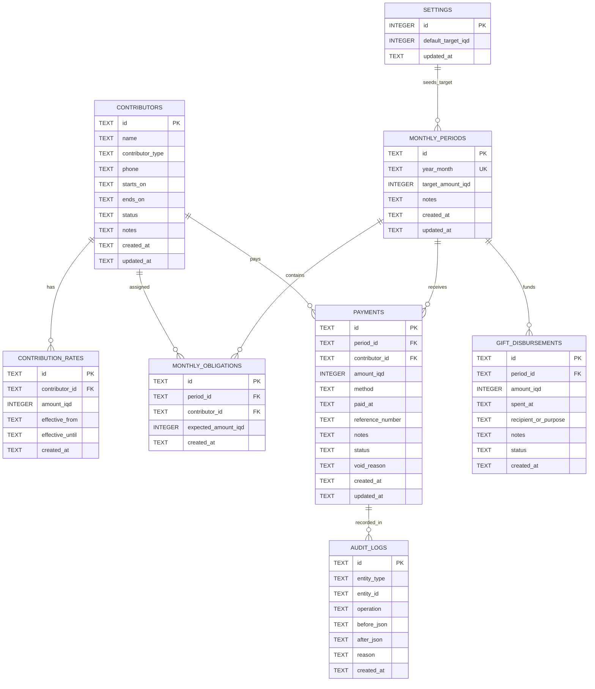
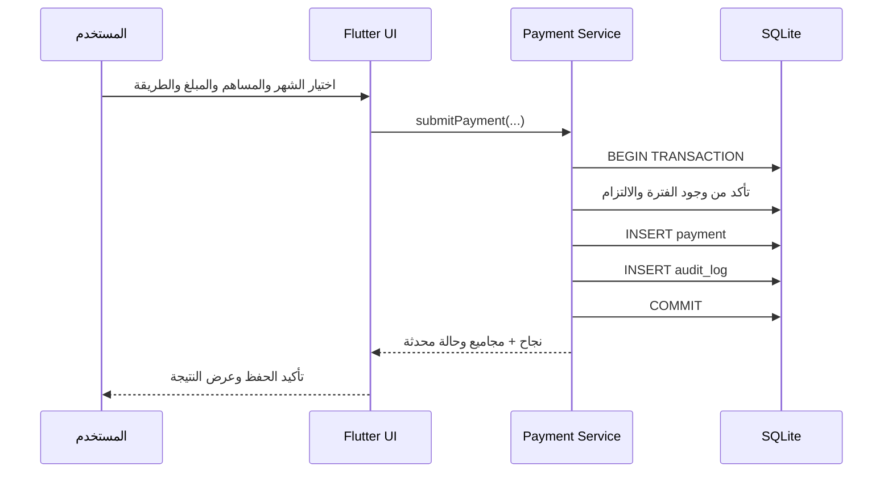

# وثيقة المتطلبات وتصميم قاعدة البيانات (PRD + ERD)
## تطبيق إدارة مساهمات كفالة الأيتام — Orphan Sponsorship Contributions

| البند | القيمة |
|---|---|
| الإصدار | 1.0 |
| التاريخ | 2026-10-24 |
| المنصة | Android باستخدام Flutter |
| اللغة والاتجاه | العربية، RTL |
| التخزين | SQLite محلي (Offline-first) |
| النطاق | مستخدم إداري واحد محلياً في الإصدار الأول |
| العملة | الدينار العراقي IQD، أعداد صحيحة دون كسور |
| حالة الوثيقة | مواصفات أولية جاهزة لبدء التنفيذ؛ الافتراضات مذكورة صراحة |

---

## 1. الملخص التنفيذي
تطبيق محلي لتوثيق المساهمين (أشخاص أو أقسام/مجموعات) والمبالغ المتفق عليها، وتسجيل دفعة أو أكثر لكل مساهم في شهر محدد، مع تحديد طريقة الدفع (نقدي/إلكتروني) وملاحظات، وإظهار حالات التسديد والملخصات الشهرية والسنوية والفائض فوق مبلغ الكفالة المستهدف، وسجل مصروفات الهدايا عند اعتمادها.

**مبدأ محاسبي:** المبلغ المحصّل لا يساوي المبلغ المصروف. **الفائض المحسوب = MAX(إجمالي المقبوضات − هدف الكفالة، 0)**؛ ولا يُعد الفائض «هدية مصروفة» إلا إذا سُجل صرفه في سجل مستقل. يمنع التطبيق الخلط بين الهدف، والتحصيل، وتخصيص الكفالة، والصرف الفعلي.

## 2. أهداف المنتج
1. إدخال مساهمة شهرية خلال خطوات قليلة مع إمكانية البحث عن المساهم.
2. معرفة من سدد كلياً أو جزئياً أو لم يسدد، بحسب الالتزام الشهري لكل مساهم.
3. حساب المقبوضات النقدية والإلكترونية وإجمالي الشهر بدقة.
4. تمييز عدم تحقيق هدف الكفالة باللون الأحمر وتحقيقه أو تجاوزه بالأخضر.
5. استعراض سجل أي مساهم ضمن شهر أو فترة أو سنة، وسجل جميع الأشهر.
6. إتاحة النسخ الاحتياطي والاستعادة وعمليات التصدير والتدقيق.

## 3. النطاق والافتراضات
### ضمن الإصدار الأول (MVP)
- ملف للمساهمين مع بحث وتفعيل وإيقاف وأرشفة.
- التزامات شهرية بقيمة افتراضية لكل مساهم، مع دعم تغيير القيمة بتاريخ نفاذ.
- اختيار السنة والشهر، وإنشاء الفترة تلقائياً عند الحاجة.
- تسجيل دفعات متعددة، ونقدي/إلكتروني، وإضافة ملاحظات ومرجع عملية اختياري.
- تعديل دفعة أو إبطالها بصورة قابلة للتدقيق، دون حذف نهائي من واجهة المستخدم.
- لوحة مؤشرات للشهر وحالات السداد وسجل الفترات وتقارير الأفراد.
- ضبط هدف الكفالة العام، وتثبيت نسخة من قيمته لكل فترة مع إمكان تعديلها.
- توثيق مصروفات الهدية اختيارياً؛ تقارير فائض غير مصروف.
- قاعدة SQLite محلية، نسخ احتياطي مشفر وتصدير CSV.

### خارج النطاق حالياً
- الربط المصرفي أو التحقق الآلي من الحوالات.
- بوابة دفع فعلية أو إرسال رسائل واتساب تلقائياً.
- مزامنة خادم أو العمل الجماعي المتزامن (يمكن إضافة ذلك مستقبلاً).
- توزيع أموال الكفالة على أيتام بأسمائهم أو متابعة مصروفات رعايتهم تفصيلياً.

### افتراضات تحتاج اعتماداً عند التطوير
- المساهمة اختيارية من حيث الدفع لكن لكل مساهم **التزام شهري متوقع** يستخدم لتحديد «مسدد بالكامل / جزئي / غير مسدد».
- المساهم الذي يبدأ في منتصف الشهر يدخل في كشف الشهر المحدد بتاريخ بدء الاشتراك؛ الأشهر السابقة لا تتأثر.
- «الهدية» في القائمة تعني افتراضياً *الفائض المتوقع*؛ أما **الهدية المصروفة** فلها سجل إنفاق مستقل.
- إذا تجاوزت المقبوضات الهدف ولم يُسجل صرف، يعد الزائد فائضاً غير مصروف.
- لا يتم ترحيل الفائض بين الأشهر تلقائياً في MVP.

## 4. الأدوار
**مدير التطبيق المحلي:** إدارة المساهمين والإعدادات والدفعات والتقارير والنسخ الاحتياطية. لا توجد صلاحيات متعددة في MVP. يوصى بقفل اختياري برمز محلي/بصمة وفق قدرات الجهاز.

## 5. الشاشات وتجربة المستخدم
| الشاشة | الوظائف الرئيسية |
|---|---|
| الرئيسية | اختيار شهر/سنة، المجموع، نقدي، إلكتروني، المستهدف، مقدار النقص/الفائض، عدد المسددين وغير المسددين |
| المساهمون | قائمة، بحث، إضافة، تعديل، سجل كل مساهم، إيقاف/أرشفة |
| إدخال دفعة | الشهر، بحث المساهم، الالتزام المتوقع، مبلغ الدفعة، طريقة الدفع، تاريخ الدفعة، مرجع وملاحظات |
| مدفوعات الشهر | جميع الدفعات، فلاتر بحسب طريقة الدفع والمساهم، تعديل/إبطال |
| حالات التسديد | كامل، جزئي، غير مسدد، مع المتبقي لكل مساهم |
| الأشهر | بطاقات لكل شهر تتضمن المحصّل والهدف والفائض والنقدي والإلكتروني وعدد حالات السداد |
| تقرير المساهم | نطاق تاريخ، مجموع الدفعات، تفصيل شهري وتوزيع طرق الدفع وتصدير |
| الهدية/الصرف | فائض محسوب، تسجيل صرف هدية، رصيد فائض غير مصروف |
| الإعدادات | الهدف الافتراضي، إدارة النسخ الاحتياطي والاستعادة، قفل التطبيق، إعدادات العرض |

### 5.1 مثال الشهر التاسع
| المساهم | المبلغ (د.ع) | الطريقة |
|---|---:|---|
| هشام | 20,000 | إلكتروني |
| محمد نادر | 25,000 | إلكتروني |
| المراقبة | 25,000 | نقدي |
| الإدارية | 25,000 | نقدي |
| **الإجمالي** | **95,000** | **45,000 إلكتروني + 50,000 نقدي** |

### 5.2 بيانات نموذجية للوحة
عند تحصيل **225,000 د.ع** وهدف **200,000 د.ع**: المخصص المستهدف للكفالة 200,000؛ الفائض المحسوب 25,000، ونسبة تحقيق الهدف 112.5%. إذا سُجل صرف هدية قدره 10,000 يصبح الرصيد غير المصروف من الفائض 15,000 (وفق سياسة تخصيص مبالغ الهدايا المحددة في القسم 8).

## 6. المتطلبات الوظيفية (Functional Requirements)
| المعرّف | المتطلب | الأولوية | معيار القبول |
|---|---|---|---|
| FR-01 | إضافة مساهم: اسم ونوع وقيمة شهرية افتراضية وتاريخ بداية | P0 | يظهر في قائمة المساهمين ولا يتكرر معرّفه |
| FR-02 | تعديل بيانات المساهم وأرشفته دون حذف سجلاته | P0 | تبقى التقارير التاريخية سليمة |
| FR-03 | تاريخ صلاحية لقيمة الالتزام الشهري | P0 | تغيير قيمة تشرين الأول لا يغير التزام أيلول |
| FR-04 | إنشاء/اختيار فترة YYYY-MM مع هدف كفالة مستقل | P0 | لكل شهر في السنة سجل وحيد |
| FR-05 | البحث عن مساهم أثناء إنشاء الدفعة | P0 | يظهر اسمه والتزامه والمتبقي في الشهر |
| FR-06 | تسجيل دفعات متعددة للشخص في الشهر | P0 | المجموع وحالة التسديد محدثان دون تكرار عدد المساهمين |
| FR-07 | دعم نقدي وإلكتروني مع التاريخ والملاحظات والمرجع | P0 | مجموع النوعين يساوي إجمالي المقبوضات |
| FR-08 | احتساب مدفوع بالكامل / جزئي / غير مدفوع | P0 | وفق إجمالي دفعات الشهر مقارنة بالالتزام الساري |
| FR-09 | احتساب هدف الكفالة والفائض والنقص وألوان المؤشر | P0 | أحمر إذا الإجمالي أقل من الهدف؛ أخضر بخلاف ذلك |
| FR-10 | جدول الأشهر والبحث بالسنة | P0 | بيانات الشهر متسقة مع دفعاته الفعلية |
| FR-11 | تقرير مساهم بنطاق من شهر إلى شهر | P0 | يعرض كل شهر ولو دون دفعات ضمن فترة اشتراكه |
| FR-12 | تعديل دفعة/إبطالها مع حفظ تدقيق العملية | P0 | لا تدخل الدفعة الملغاة في الإجماليات |
| FR-13 | ضبط الهدف الافتراضي ومنع تغيير الشهور القديمة تلقائياً | P0 | التعديل يسري على الفترات الجديدة فقط |
| FR-14 | تسجيل صرف هدية اختياري، مستقل عن الفائض النظري | P1 | يظهر المبلغ المصروف والمتبقي بشكل منفصل |
| FR-15 | تصدير تقرير CSV مع دعم UTF-8 BOM للعربية | P1 | قابل للفتح في برامج الجداول |
| FR-16 | إنشاء واستعادة نسخة احتياطية مشفرة محلياً | P1 | استعادة صحيحة بعد التحقق من سلامة النسخة |
| FR-17 | قفل محلي اختياري مع المصادقة الحيوية | P1 | لا تكشف البيانات دون تجاوز القفل عند تفعيله |
| FR-18 | مرشحات: الشهر، حالة الدفع، طريقة الدفع | P0 | النتائج والأعداد تتغير بصورة صحيحة |

## 7. قواعد العمل (Business Rules)
1. الدفعة مبلغ صحيح موجب بالدينار العراقي؛ لا تقبل الصفر أو الأعداد السالبة.
2. طرق الدفع في MVP: `cash` و`electronic`، ولكل دفعة طريقة واحدة؛ التقسيم يتم بدفعتين منفصلتين.
3. جميع التواريخ تخزن ISO-8601، وتُعرض وفق المنطقة الزمنية المحلية؛ الفترة الشهرية محددة بـ `YYYY-MM`.
4. يُنصح بتسجيل وقت الإدخال `created_at` ووقت الدفع `paid_at` منفصلين لتغطية الدفعات المدخلة لاحقاً.
5. المدفوع بالكامل إذا كان مجموع الدفعات الفعالة للشهر ≥ الالتزام؛ جزئياً إذا كان بين 0 والالتزام؛ غير مدفوع إذا كان 0.
6. المساهم متوقف/مؤرشف لا يدخل في مقامات الأشهر بعد تاريخ إيقافه؛ لكنه يبقى في التقارير التاريخية.
7. إجمالي النقدي = مجموع الدفعات الفعالة النقدية، والإلكتروني بالمثل.
8. لا يعاد احتساب الالتزامات التاريخية بأثر رجعي بعد تعديل الالتزام الافتراضي؛ يُحفظ **لقطة الالتزام الشهرية**.
9. عند أول عرض لشهر يجب إنشاء التزامات المساهمين الفعالين لذلك الشهر أو توليدها بصورة حتمية؛ تتجمد قيمة الالتزام عند إنشاء سجل `monthly_obligations`.
10. يُسمح بدفع أكثر من الالتزام ويصنف مسدداً بالكامل، مع الاحتفاظ بالزيادة في مجموع الشهر.
11. لا تُحذف الدفعات نهائياً؛ يتم إبطالها مع السبب وتسجيل الأثر.
12. يُسمح بتعديل مبلغ الهدف الخاص بشهر معين بعد رسالة تحذير؛ لا تتغير المقبوضات.
13. لا يساوي «عدد المسددين» عدد الدفعات؛ كل مساهم يحسب مرة واحدة فقط في الشهر.
14. مؤشر «المسددين» المقترح يعني المسددين بالكامل. تعرض الجزئيات في مؤشر مستقل، وغير المسددين يعني من دفعوا صفراً؛ لا تختلط الحالات.
15. لا يجوز صرف هدايا تتجاوز الفائض المتاح في الشهر إن كانت السياسة «الصرف من فائض الشهر فقط»؛ يوضح التطبيق الخطأ للمستخدم.

## 8. قواعد الحساب
لتكن `payments(month)` الدفعات الفعالة وحدها:

```text
cash_total        = SUM(amount WHERE method = 'cash')
electronic_total  = SUM(amount WHERE method = 'electronic')
collected_total   = cash_total + electronic_total
target            = sponsorship_target_amount of selected month
coverage_amount   = MIN(collected_total, target)
shortfall         = MAX(target - collected_total, 0)
surplus           = MAX(collected_total - target, 0)
progress_percent  = IF target > 0 THEN collected_total * 100 / target ELSE N/A
spent_gifts       = SUM(active gift disbursements in month)
unspent_surplus   = surplus - spent_gifts
```

**التمييز المحاسبي:** `coverage_amount` مبلغ نظري مخصص لتغطية هدف الكفالة، **ليس دليلاً على تسليم كفالة فعلياً**. إن احتاج التطبيق لاحقاً إلى إثبات التحويل للكفالة تُضاف شاشة مصروفات/تسويات مستقلة. يمنع صرف هدية إن أصبحت `unspent_surplus` سالبة، ويمنع خفض التحصيل بإبطال دفعة إذا صار الصرف المسجل أعلى من الفائض إلا بعد معالجة المصروفات أو الموافقة على تسوية صريحة.

مثال: شهر 8: إذا كان التحصيل 300,000 والهدف 200,000، الفائض 100,000 وليس 100,000 إذا كانت الكفالة 2,000,000؛ المثال السابق للمستخدم «2,000,000» متعارض مع الهدية 100,000، لذا يجب إدخال الهدف الحقيقي وتطبيق المعادلة لا نسخ الرقم حرفياً.

## 9. النموذج التقني
- Flutter (أحدث إصدار مستقر وقت البدء)، تصميم Material 3، RTL، تنسيق IQD بدون كسور.
- State management: Riverpod (أو Bloc؛ اختيار نهائي واحد فقط).
- SQLite عبر `drift` للـ migrations والـ typed queries والمعاملات، أو `sqflite` مع طبقة Repository؛ **المقترح Drift**.
- طبقات `presentation / application / domain / data` مع فصل DTO وEntity.
- العمليات المالية تتم داخل معاملات قاعدة بيانات `transaction` وتتحقق من القيود على مستوى التطبيق وقاعدة البيانات.
- لا اتصال بخادم أو إنترنت في MVP. معرفات UUID نصية مناسبة للتوسعة مستقبلاً.

### هيكل المشروع المقترح
```text
lib/
  app/                   # bootstrap, routing, theme, localization
  core/                  # errors, date, money, security, utilities
  features/
    contributors/        # pages, controllers, domain, repositories
    periods/
    payments/
    obligations/
    dashboard/
    reports/
    gift_disbursements/
    settings/
    backup/
  data/
    local/database.dart  # Drift database + migrations + DAOs
    audit/
test/
integration_test/
```

## 10. ERD — مخطط الكيانات والعلاقات
> يدعم Mermaid معظم عارضات Markdown ومنها VS Code بملحق Mermaid وGitHub.



**ملاحظة:** ربط `PAYMENTS` بـ `AUDIT_LOGS` في الرسم رابط منطقي عبر `entity_type + entity_id` وليس مفتاحاً خارجياً مادياً، لأن سجل التدقيق يخدم كيانات متعددة. وكذلك الربط `SETTINGS → MONTHLY_PERIODS` يعبر عن نسخ قيمة الهدف الافتراضي عند إنشاء الفترة، وليس FK.

## 11. قاموس البيانات والقيود
### CONTRIBUTORS
- `id TEXT PRIMARY KEY` UUID، `name TEXT NOT NULL`، `contributor_type TEXT` من `person/department/group`.
- `starts_on TEXT NOT NULL` و`ends_on TEXT NULL` بنمط `YYYY-MM-DD`، `status TEXT` من `active/paused/archived`.
- لا يجوز أن يكون `ends_on` أقدم من `starts_on`.

### CONTRIBUTION_RATES
- قيمة الالتزام `amount_iqd INTEGER NOT NULL CHECK(amount_iqd >= 0)`، `effective_from` و`effective_until`.
- لا يسمح بتداخل المدد للمساهم الواحد؛ تطبق قاعدة عدم التداخل في Repository ضمن transaction.
- القيمة الفعالة للشهر تُحدد وفق **أول يوم من الشهر** في MVP، لتجنب الغموض عند تعديل القيمة وسط الشهر.

### MONTHLY_PERIODS
- `year_month TEXT NOT NULL UNIQUE` بصيغة `YYYY-MM`، و`target_amount_iqd INTEGER NOT NULL CHECK(target_amount_iqd > 0)`.

### MONTHLY_OBLIGATIONS
- قيد `UNIQUE(period_id, contributor_id)`، `expected_amount_iqd >= 0`، يحفظ مبلغ الالتزام المتوقع وقت إنشاء الكشف الشهري.
- مصدر قائمة المسددين وغير المسددين هو هذا الجدول وليس جدول المدفوعات وحده.

### PAYMENTS
- `amount_iqd INTEGER NOT NULL CHECK(amount_iqd > 0)`.
- `method IN ('cash','electronic')` و`status IN ('active','void')`.
- `period_id` و`contributor_id` إلزاميان؛ يلزم توافق الدفع مع سجل التزام شهري موجود (فحص تطبيقي ضمن transaction).
- `paid_at` وقت الدفع، و`created_at` وقت الإدخال؛ `void_reason` مطلوب إذا كانت الحالة `void`.

### GIFT_DISBURSEMENTS
- `amount_iqd > 0`، `status IN ('active','void')`، والغرض/المستلم موثقان.
- لا يجوز تجاوز مجموع مصروفات الهدايا النشطة فائض الشهر، مع إعادة التحقق عند أي تعديل دفعة/هدف.

### SETTINGS
- صف وحيد `id = 1`، `default_target_iqd > 0`؛ القيمة الابتدائية المقترحة 200000 دينار.

## 12. مثال DDL لقاعدة SQLite
> هذا المخطط قابل للتنفيذ، ويضاف له جدول ترحيلات (`schema_migrations`) عبر Drift. تحقق التواريخ وتداخل مدد الاشتراك وسقف الهدية يكون في Domain Service ومعاملات قاعدة البيانات.

```sql
PRAGMA foreign_keys = ON;

CREATE TABLE contributors (
 id TEXT PRIMARY KEY,
 name TEXT NOT NULL,
 contributor_type TEXT NOT NULL DEFAULT 'person'
   CHECK (contributor_type IN ('person','department','group')),
 phone TEXT,
 starts_on TEXT NOT NULL,
 ends_on TEXT,
 status TEXT NOT NULL DEFAULT 'active'
   CHECK (status IN ('active','paused','archived')),
 notes TEXT,
 created_at TEXT NOT NULL,
 updated_at TEXT NOT NULL,
 CHECK (ends_on IS NULL OR ends_on >= starts_on)
);

CREATE TABLE contribution_rates (
 id TEXT PRIMARY KEY,
 contributor_id TEXT NOT NULL REFERENCES contributors(id) ON DELETE RESTRICT,
 amount_iqd INTEGER NOT NULL CHECK (amount_iqd >= 0),
 effective_from TEXT NOT NULL,
 effective_until TEXT,
 created_at TEXT NOT NULL,
 CHECK (effective_until IS NULL OR effective_until >= effective_from)
);
CREATE INDEX idx_rates_contributor_dates ON contribution_rates(contributor_id,effective_from);

CREATE TABLE settings (
 id INTEGER PRIMARY KEY CHECK (id = 1),
 default_target_iqd INTEGER NOT NULL CHECK (default_target_iqd > 0),
 updated_at TEXT NOT NULL
);

CREATE TABLE monthly_periods (
 id TEXT PRIMARY KEY,
 year_month TEXT NOT NULL UNIQUE
   CHECK (length(year_month)=7 AND substr(year_month,5,1)='-'
       AND CAST(substr(year_month,6,2) AS INTEGER) BETWEEN 1 AND 12),
 target_amount_iqd INTEGER NOT NULL CHECK (target_amount_iqd > 0),
 notes TEXT,
 created_at TEXT NOT NULL,
 updated_at TEXT NOT NULL
);

CREATE TABLE monthly_obligations (
 id TEXT PRIMARY KEY,
 period_id TEXT NOT NULL REFERENCES monthly_periods(id) ON DELETE RESTRICT,
 contributor_id TEXT NOT NULL REFERENCES contributors(id) ON DELETE RESTRICT,
 expected_amount_iqd INTEGER NOT NULL CHECK (expected_amount_iqd >= 0),
 created_at TEXT NOT NULL,
 UNIQUE (period_id, contributor_id)
);
CREATE INDEX idx_obligations_period ON monthly_obligations(period_id);

CREATE TABLE payments (
 id TEXT PRIMARY KEY,
 period_id TEXT NOT NULL REFERENCES monthly_periods(id) ON DELETE RESTRICT,
 contributor_id TEXT NOT NULL REFERENCES contributors(id) ON DELETE RESTRICT,
 amount_iqd INTEGER NOT NULL CHECK (amount_iqd > 0),
 method TEXT NOT NULL CHECK (method IN ('cash','electronic')),
 paid_at TEXT NOT NULL,
 reference_number TEXT,
 notes TEXT,
 status TEXT NOT NULL DEFAULT 'active' CHECK (status IN ('active','void')),
 void_reason TEXT,
 created_at TEXT NOT NULL,
 updated_at TEXT NOT NULL,
 CHECK (status <> 'void' OR length(trim(coalesce(void_reason,''))) > 0)
);
CREATE INDEX idx_payments_period_status_method ON payments(period_id,status,method);
CREATE INDEX idx_payments_contributor_period ON payments(contributor_id,period_id);

CREATE TABLE gift_disbursements (
 id TEXT PRIMARY KEY,
 period_id TEXT NOT NULL REFERENCES monthly_periods(id) ON DELETE RESTRICT,
 amount_iqd INTEGER NOT NULL CHECK (amount_iqd > 0),
 spent_at TEXT NOT NULL,
 recipient_or_purpose TEXT NOT NULL,
 notes TEXT,
 status TEXT NOT NULL DEFAULT 'active' CHECK (status IN ('active','void')),
 created_at TEXT NOT NULL
);
CREATE INDEX idx_gifts_period_status ON gift_disbursements(period_id,status);

CREATE TABLE audit_logs (
 id TEXT PRIMARY KEY,
 entity_type TEXT NOT NULL,
 entity_id TEXT NOT NULL,
 operation TEXT NOT NULL,
 before_json TEXT,
 after_json TEXT,
 reason TEXT,
 created_at TEXT NOT NULL
);
CREATE INDEX idx_audit_entity ON audit_logs(entity_type,entity_id,created_at);

INSERT INTO settings(id,default_target_iqd,updated_at)
VALUES (1,200000,strftime('%Y-%m-%dT%H:%M:%fZ','now'));
```

## 13. الاستعلامات الأساسية
### إجماليات شهر محدد
```sql
SELECT
 COALESCE(SUM(CASE WHEN method='cash' THEN amount_iqd ELSE 0 END),0) AS cash_total,
 COALESCE(SUM(CASE WHEN method='electronic' THEN amount_iqd ELSE 0 END),0) AS electronic_total,
 COALESCE(SUM(amount_iqd),0) AS collected_total
FROM payments
WHERE period_id = :period_id AND status='active';
```

### حالات تسديد جميع المساهمين في شهر
```sql
WITH paid AS (
 SELECT contributor_id, SUM(amount_iqd) AS amount_paid
 FROM payments
 WHERE period_id=:period_id AND status='active'
 GROUP BY contributor_id
)
SELECT c.id,c.name,mo.expected_amount_iqd,
       COALESCE(p.amount_paid,0) AS paid_iqd,
       MAX(mo.expected_amount_iqd-COALESCE(p.amount_paid,0),0) AS remaining_iqd,
       CASE
         WHEN COALESCE(p.amount_paid,0)=0 THEN 'unpaid'
         WHEN COALESCE(p.amount_paid,0)>=mo.expected_amount_iqd THEN 'paid'
         ELSE 'partial'
       END AS payment_status
FROM monthly_obligations mo
JOIN contributors c ON c.id=mo.contributor_id
LEFT JOIN paid p ON p.contributor_id=mo.contributor_id
WHERE mo.period_id=:period_id
ORDER BY c.name;
```

### تقرير شخص عبر فترة أشهر
```sql
SELECT mp.year_month, mo.expected_amount_iqd,
       COALESCE(SUM(CASE WHEN p.status='active' AND p.method='cash' THEN p.amount_iqd ELSE 0 END),0) AS cash_iqd,
       COALESCE(SUM(CASE WHEN p.status='active' AND p.method='electronic' THEN p.amount_iqd ELSE 0 END),0) AS electronic_iqd
FROM monthly_obligations mo
JOIN monthly_periods mp ON mp.id=mo.period_id
LEFT JOIN payments p ON p.period_id=mo.period_id AND p.contributor_id=mo.contributor_id
WHERE mo.contributor_id=:contributor_id
 AND mp.year_month BETWEEN :from_month AND :to_month
GROUP BY mp.id,mp.year_month,mo.expected_amount_iqd
ORDER BY mp.year_month;
```

## 14. تتابع تسجيل دفعة


## 15. متطلبات غير وظيفية
- **الأداء:** فتح القوائم وتحديث الإجماليات سريع محلياً حتى مع عشرات آلاف الدفعات؛ فهارس قاعدة البيانات ضرورية.
- **الموثوقية:** جميع عمليات الإضافة والتعديل والإبطال تسجل بمعاملات ذرية.
- **الحماية:** حفظ قاعدة البيانات في مساحة التطبيق الخاصة؛ تشفير النسخ الاحتياطية باستخدام خوارزمية موثوقة وكلمة مرور مستقلة؛ لا تحفظ كلمات المرور بصيغة صريحة.
- **خصوصية البيانات:** تجنب جمع معلومات حساسة لا يحتاجها النظام، وتعطيل نسخ محتوى شاشة البيانات إلى سجلات debug في إصدار الإنتاج.
- **الاستعادة:** نسخة احتياطية ببيانات إصدار المخطط، والتحقق من سلامة الملف قبل استبدال قاعدة البيانات؛ الاحتفاظ بالقديمة حتى نجاح الاستعادة.
- **إمكانية الاستخدام:** دعم RTL وخط عربي مقروء، وفواصل آلاف، ورسائل خطأ واضحة، وألوان مع أيقونات/نصوص كي لا يعتمد التمييز على اللون وحده.
- **التشغيل دون اتصال:** جميع وظائف MVP تعمل دون إنترنت.

## 16. حالات الاختبار والقبول
| ID | السيناريو | النتيجة المتوقعة |
|---|---|---|
| TC-01 | 20 ألف إلكتروني + 25 ألف إلكتروني + 25 ألف نقدي + 25 ألف نقدي | إجمالي 95,000، نقدي 50,000، إلكتروني 45,000 |
| TC-02 | هدف 200,000 وتحصيل 199,999 | نقص 1، مؤشر أحمر |
| TC-03 | هدف 200,000 وتحصيل 200,000 | فائض صفر، مؤشر أخضر |
| TC-04 | هدف 200,000 وتحصيل 225,000 | فائض 25,000، نسبة 112.5% |
| TC-05 | مساهم التزامه 25,000 دفع 10,000 ثم 15,000 | «مسدد بالكامل» ويحسب مساهم واحد |
| TC-06 | مساهم فعّال لم يدفع | «غير مسدد» ويظهر في القائمة |
| TC-07 | إبطال دفعة إلكترونية 5,000 مع سبب | تنخفض الإجماليات 5,000 ويسجل تدقيق |
| TC-08 | تعديل الالتزام اعتباراً من تشرين الأول | بيانات أيلول لا تتغير |
| TC-09 | تغيير الهدف الافتراضي في الإعدادات | الأشهر المنشأة سابقاً لا تتغير |
| TC-10 | مساهم دفع فوق التزامه | حالة كامل، والزيادة تدخل المقبوضات |
| TC-11 | صرف هدية يتجاوز الفائض | رفض العملية برسالة واضحة |
| TC-12 | إبطال دفعة يؤدي إلى فائض أقل من هدايا مصروفة | رفض العملية حتى إجراء التسوية |
| TC-13 | طلب تقرير مساهم على 12 شهراً | ظهور أشهر الاشتراك بلا دفعات بقيم صفر |
| TC-14 | حفظ شهر 9 لسنتين مختلفتين | سجلان مستقلان دون تداخل |
| TC-15 | إضافة مبلغ صفر أو سالب | رفض الإدخال |
| TC-16 | استعادة نسخة احتياطية تالفة | خطأ دون فقد قاعدة البيانات الحالية |
| TC-17 | إغلاق التطبيق ثم فتحه دون إنترنت | جميع البيانات موجودة ومحدثة |
| TC-18 | إضافة دفعتين بطرقتين مختلفتين للمساهم ذاته | توزيع صحيح بين النقدي والإلكتروني |

## 17. خارطة التنفيذ المقترحة
**المرحلة 1:** إعداد Flutter وDrift والموديلات والترحيلات وقفل الشاشة الاختياري.

**المرحلة 2:** CRUD المساهمين وتواريخ الالتزام وتوليد الفترات والالتزامات الشهرية.

**المرحلة 3:** تسجيل الدفعات والإبطال وسجل التدقيق والتحقق المالي.

**المرحلة 4:** اللوحة الرئيسية والملخص الشهري والفلاتر وتقارير الأشهر والأشخاص.

**المرحلة 5:** سجل الهدايا والتصدير والنسخ الاحتياطي والاختبارات وتسليم APK.

## 18. معايير التسليم Definition of Done
1. تطبيق Android APK قابل للتثبيت يعمل بلا اتصال.
2. نسخة مصدر Flutter منظمة مع تعليمات بناء وتشغيل.
3. SQLite migrations مع اختبارات للقيود والاستعلامات.
4. تنفيذ جميع متطلبات P0 واختباراتها دون فشل.
5. التأكد يدوياً من الأرقام في سيناريوهات القسم 16.
6. اختبار نسخ احتياطي ثم حذف/إعادة تثبيت على بيئة اختبار ثم استعادة سليمة.
7. ملف README يشرح اختيار الشهر، إدخال الدفعة، الحالات، معادلة الفائض، وإبطال الدفعات.

---

**ملاحظة نهائية للمطور:** تُعامل جميع القيم بوصفها ديناراً عراقياً صحيحاً (`int` / SQLite `INTEGER`) وتُشتق الإجماليات من دفعات نشطة فقط. لا تخزن مجاميع مالية مشتقة في جداول الأشهر حتى لا تتعارض مع حركات التعديل أو الإبطال. عند التوسع إلى المزامنة يجب إضافة سجل تغيير وحقول نسخة/زمن تعديل وآلية فض التعارض قبل طرح ميزة تعدد الأجهزة.
